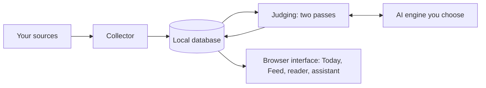

# Spyglass

**Spyglass is a personal research radar that runs on your own computer.**

You tell Spyglass which sources to read and describe your interests in a short written profile.
Spyglass collects new items from those sources every few hours, asks an AI model to judge each one
against your profile, and shows you what passed in a daily brief you can finish in a few minutes.
Each item opens in a clean reader with a summary and an assistant that answers questions about it.
Spyglass is for one person who follows a fast-moving field, such as AI, medical technology or a
group of companies, and who wants a short, finite reading list instead of an endless stream.

Spyglass is a background service with a web interface. It needs no account and has no server of
its own. Your data stays in a database on your computer, and Spyglass sends out only the requests
listed in [Privacy and safety](#privacy-and-safety).

## What you get

### The core loop

1. **You choose the sources.** RSS and Atom feeds, news searches on your topics, Hacker News, the
   daily list of new papers on Hugging Face and arXiv keyword searches. A starting set of feeds is
   installed on the first run.
2. **Spyglass collects on a schedule.** It collects every two hours while it runs.
3. **An AI model judges each item in two passes.** A low-cost first pass reads the title and the
   snippet. Items that score high enough get a second pass, which reads the full text and writes a
   headline, key points and a line on why the item matters to you.
4. **You read the result.** **Today** is a daily brief composed each morning: top stories, news
   about the organisations you watch, other items worth knowing, papers, everything you sent in,
   and a list of headlines to skim. It ends with "You are caught up". The **Feed** lists every
   collected item with filters, search and date headings.
5. **You open an item in the reader.** The reader shows a clean copy of the page with its headings,
   images and tables, and the summary on top.
6. **You ask the assistant.** The assistant beside the reader answers about the whole item or about
   a passage you select, with the AI engine you choose. Quick actions explain the item, say how it
   relates to you, or draft a message, a LinkedIn post or a blog outline.
7. **You keep what matters.** One click saves an item inside Spyglass. You can also send in your
   own links, pages and files, and Spyglass always reads them.

### Around the core

- **Watch.** A list of companies, labs and regulators, searched every day. Spyglass proposes new
  names, which wait for your approval. Groups on the list have their own actions, and an AI review
  of the list suggests changes. For watched companies, Spyglass also reads FDA device decisions
  (510(k) clearances, De Novo grants, PMA approvals and recalls) from the public openFDA service.
- **Find papers.** You type a topic, and Spyglass returns the few papers that matter, each with one
  line on how it relates to your field.
- **Ask about the whole Feed.** The assistant also answers questions across the Feed, with numbered
  citations that link to the items it used.
- **Missed** shows the top and notable items of the last seven days that you have not opened,
  saved or filed. **Related** shows items close to the one you are reading.
- **A browser extension** sends the page you are reading to Spyglass. See
  [Sending things in](#sending-things-in).
- **Capture** from Raindrop bookmarks, a Slack channel and a Gmail label.
- **A usage record** of every model call (tokens read, tokens written, cost reported by the
  provider), shown as a table for the last seven days under Settings.
- **A Help page** inside the app.

The [user guide](docs/user-guide.md) describes the daily routine in plain language.

## How it works

- A Python service ([FastAPI](https://fastapi.tiangolo.com/)) runs in the background on your
  computer and listens only on `127.0.0.1`, port 7777.
- A built-in scheduler collects, judges, composes the brief, searches the watch list and makes a
  nightly backup.
- Everything is stored in one SQLite database in a data folder in your home folder.
- The interface is a React application that the service serves. You open it in a browser window.
- The AI engines are services you choose: a cloud provider with your own key, a model server on
  your computer, or a command-line AI tool you already have installed.
- A small embedding model runs on your computer to find related items. It is downloaded once.
- Pages are fetched by the service itself, through a guarded connection that accepts only public
  addresses.



## Requirements

| What | Version or detail |
|------|-------------------|
| Operating system | Windows 10 or 11. This is the only tested system. The service is plain Python and should run on macOS and Linux, but nobody has tested it there, and the start scripts are for Windows only. |
| [uv](https://docs.astral.sh/uv/) | Creates the Python environment from the lock file. |
| Python | 3.12 or newer (uv can install it for you). |
| [Node.js](https://nodejs.org/) | 20.19 or newer, or 22.12 or newer. It is needed once, to build the interface. |
| An AI engine | Needed for judging, the brief and the assistant. Without one, collection and search work, but no item is judged. See [Choosing an AI engine](#choosing-an-ai-engine). |

## Install and first run

1. Get the code and create the Python environment.

   ```
   git clone https://github.com/ekmungi/spyglass.git
   cd spyglass
   uv sync
   ```

   `uv sync` creates a `.venv` folder with every dependency from `uv.lock`.

2. Install the browser that Spyglass uses for pages that show their text only in a real browser.

   ```
   uv run patchright install chromium
   ```

   This step is recommended. Without it, the last fetch method is not available, and such pages
   cannot be read.

3. Build the interface. The built files (`frontend/dist`) are not in the repository.

   ```
   cd frontend
   npm install
   npm run build
   cd ..
   ```

   The build writes `frontend/dist`. Without it, the service shows a placeholder page.

4. Start the service from the repository folder.

   ```
   uv run python -m spyglass_service
   ```

   The log ends with a line saying that the server is running on `http://127.0.0.1:7777`. The first
   start creates the data folder and the database, installs the starting feeds and begins the
   first collection.

5. Open `http://127.0.0.1:7777/` in your browser.

6. Set up Spyglass in the app.
   - Open **Settings** and add an AI engine (the next section explains the choices).
   - Open **Profile** and replace the example profile with your own interests. The profile is
     what every item is judged against.
   - Open **Sources** and add or remove feeds. Open **Watch** and add the organisations you follow.
   - Wait for the next collection, or press the collect button on **Sources** to start one now.
     The first brief is composed at 06:30 the next morning by default.

**On Windows**, `scripts\spyglass.cmd` starts the service if it is not running and opens it in an
app-style window of Edge or Chrome. You can pin it to the taskbar. To start the service at every
sign-in, run the following command. Add `-Uninstall` to remove the task again.

```
powershell -ExecutionPolicy Bypass -File scripts\install_autostart.ps1
```

## Choosing an AI engine

Spyglass uses AI in two places. The **background judging** reads every collected item and writes
the brief. The **assistant** answers your questions in the reader and on the Feed. Each has its
own setting.

| Engine | What you need | What it costs you | Judging | Assistant |
|--------|---------------|-------------------|---------|-----------|
| OpenRouter | `OPENROUTER_API_KEY` | Pay per use. One key reaches many models. | Yes (default) | Yes |
| Google Gemini API | `GEMINI_API_KEY` or `GOOGLE_API_KEY` | Pay per use | Yes | Yes |
| Claude Code command | Claude Code installed and signed in | Your existing Claude plan | Yes | Yes, once switched on |
| Antigravity command | Google's Antigravity command installed and signed in | Your existing Google plan | Yes | Yes, once switched on |
| Anthropic API | `ANTHROPIC_API_KEY` | Pay per use | No | Yes |
| OpenAI API | `OPENAI_API_KEY` | Pay per use | No | Yes |
| Ollama, LM Studio or another OpenAI-compatible server | The server running on your computer | Nothing beyond your own hardware | No | Yes |

You can type a key into **Settings**, where Spyglass stores it in the operating system's
credential store, or set it as an environment variable or in a `.env` file. A key is only ever
sent to its own provider's address. Support for the Codex command is also included, but it has not
been tested against a real installation.

**Judging settings.** `SPYGLASS_RADAR_LLM_PROVIDER` selects the judging engine: `openrouter` (the
default), `claude_code`, `gemini` or `antigravity`. `SPYGLASS_RADAR_LLM_FALLBACK` is a
comma-separated list of engines to try, in order, when the first one cannot be used, for example
because the account is out of credit. An engine that failed is skipped for ten minutes. Both can
also be set in **Settings**.

**Command-line engines are for personal use.** Spyglass starts your own installed `claude` command
with all of its tools switched off and passes it one item and your question. Spyglass never reads
or stores a login. Whether your plan allows this kind of use depends on your agreement with the
provider. For Claude, read Anthropic's
[Consumer Terms](https://www.anthropic.com/legal/consumer-terms). If you are unsure, use an API key.

## Sending things in

**Browser extension.** The extension in [`browser-extension/`](browser-extension/README.md) works in
Chrome, Edge, Brave, Vivaldi and other Chromium browsers. It sends the open page, or only the text
you selected, to Spyglass with one click or with Alt+Shift+S. Because it hands over the page your
browser already shows, it also works for pages behind a paywall that you can read. Spyglass itself
never signs in anywhere. Install it with **Load unpacked** and paste the key from **Settings**.

The other routes:

- **Add link.** The button in the left rail accepts any public web address.
- **Raindrop.** Set `SPYGLASS_RAINDROP_TOKEN`, and your bookmarks are collected.
- **Slack.** Post a link, a PDF or a picture into one private channel, and it arrives as your own
  item. Setup is in the [user guide](docs/user-guide.md#8-connecting-slack).
- **Gmail.** Newsletters with one label, and links you mail to yourself with another, become items.
  Setup is in the [user guide](docs/user-guide.md#10-connecting-gmail).

Items you send in are always read in full and never filtered out.

## Optional integrations

These integrations are off or hidden until you set them up. Spyglass works fully without them.

- **Open in Claude Code.** In the reader, this opens a Claude Code session to discuss an item or to
  run your own request. It needs Claude Code installed and a folder set under **Settings**, Vault
  folder.
- **Filing into a notes vault.** **File in vault** adds an item to a queue inside Spyglass. Nothing
  is written at that moment. **File now** opens one Claude Code session in your notes folder, where
  your own Claude Code filing skills show a table of where each item will go and file the items
  after your approval. Spyglass never writes into the folder itself. Filing stays hidden until the
  folder and the names of your own filing plugin and skills are set (`SPYGLASS_VAULT_PATH`,
  `SPYGLASS_RADAR_FILING_PLUGIN`, `SPYGLASS_RADAR_FILING_INGEST_SKILL`,
  `SPYGLASS_RADAR_FILING_MANAGE_SKILL`). Filing runs only when you click **File now**. A background
  mode is planned and is not available in this version.
- **The Obsidian plugin (legacy).** Earlier versions of Spyglass ran inside an Obsidian plugin.
  The plugin (`plugin/`) and its Claude skills (`skills/`) are still in the repository and still
  work, but the current app does not need them.

## Privacy and safety

- **Outbound requests.** Every page, feed and image request goes through a guarded connection that
  accepts only public internet addresses. Every redirect is checked again, cookies are never sent,
  and Spyglass never signs in to a website or submits a form.
- **Keys.** Keys are kept in the operating system's credential store or in your environment, never
  in the database. Each key is bound to its own provider's host names and is checked before every
  request.
- **Prompts.** Keys, your e-mail address and paths on your computer are removed from every message
  before it reaches a model. Text from the web is marked as material to analyse, and the model is
  told that it is not instructions.
- **No tools for the model.** The assistant and the judging model cannot browse, run programs or
  write files. Their answers are shown to you as text.
- **What the provider sees.** The AI provider you choose receives your profile, the text of the
  items it judges and your assistant questions. That is how judging works, so choose a provider you
  trust with that material.
- **Known limits.** Search services see your topics, sites see your network address, and marking
  web text reduces but does not remove the risk of hidden instructions in a page.

The full account, including every service Spyglass contacts and the switches you can change, is in
[docs/privacy-and-safety.md](docs/privacy-and-safety.md). The [user guide](docs/user-guide.md)
covers the same switches from the settings page.

## Configuration reference

Every setting can be set as an environment variable or in a `.env` file in the repository folder,
which the service reads when it starts. Many settings can also be changed in **Settings**, and
those changes are kept in the data folder and applied over the environment. Settings take the
prefix `SPYGLASS_`. The provider keys are also read under their usual names, such as
`OPENROUTER_API_KEY`.

| Variable | Default | What it does |
|----------|---------|--------------|
| `SPYGLASS_PORT` | `7777` | Port the service listens on, on `127.0.0.1` only. |
| `SPYGLASS_DATA_DIR` | `.spyglass` in your home folder | Database, caches, backups and the embedding model. |
| `SPYGLASS_RADAR_LLM_PROVIDER` | `openrouter` | Engine for background judging: `openrouter`, `claude_code`, `gemini` or `antigravity`. |
| `SPYGLASS_RADAR_LLM_FALLBACK` | empty | Engines to try, in order, when the first cannot be used. |
| `SPYGLASS_RADAR_TRIAGE_MODEL` | `openai/gpt-6-luna` | OpenRouter model for the first pass (title and snippet). |
| `SPYGLASS_RADAR_DIGEST_MODEL` | `anthropic/claude-haiku-5.5` | OpenRouter model for the second pass (full text). |
| `SPYGLASS_RADAR_WRITER_MODEL` | `deepseek/deepseek-v4-flash` | OpenRouter model for small writing jobs. |
| `SPYGLASS_RADAR_DIGEST_GATE` | `50` | First-pass score (0 to 100) an item needs before its full text is read. |
| `SPYGLASS_RADAR_COLLECT_HOURS` | `2` | Hours between collections. |
| `SPYGLASS_RADAR_BRIEF_TIME` | `06:30` | Local time at which the daily brief is composed. |
| `SPYGLASS_RADAR_TIMEZONE` | empty | IANA time zone for the schedule. Empty uses the computer's zone. |
| `SPYGLASS_RADAR_BACKUP_TIME` | `03:00` | Local time of the daily database backup. |
| `SPYGLASS_BACKUP_KEEP` | `7` | Most backups kept. |
| `SPYGLASS_RADAR_RETENTION_DAYS` | `120` | Days to keep the stored text of items you never opened, saved or sent in. `0` keeps everything. |
| `SPYGLASS_RADAR_FDA_ENABLED` | `true` | Daily FDA device decisions for watched companies. |
| `SPYGLASS_BROWSER_ENABLED` | `true` | Use the hidden local browser as the last fetch method. |
| `SPYGLASS_JINA_ENABLED` | `false` | Use the outside Jina Reader service for pages that refuse every other method. |
| `SPYGLASS_PRIVACY_SEND_EXAMPLES` | `true` | Send titles of items you saved or turned down to the judging model as examples. |
| `SPYGLASS_PRIVACY_PROXY_IMAGES` | `true` | Fetch article images through the service, so your browser never contacts the image hosts. |
| `SPYGLASS_PRIVACY_ALLOW_BOT_CHECKS` | `true` | Let the hidden browser complete a site's automated bot check. |
| `SPYGLASS_RAINDROP_TOKEN` | empty | Collect your Raindrop bookmarks. |
| `SPYGLASS_SLACK_BOT_TOKEN`, `SPYGLASS_SLACK_CAPTURE_CHANNEL`, `SPYGLASS_SLACK_APP_TOKEN` | empty | Slack capture. |
| `SPYGLASS_GMAIL_ADDRESS`, `SPYGLASS_GMAIL_APP_PASSWORD` | empty | Gmail capture. |

Every setting, with a comment on what it controls, is in
[`src/spyglass_service/config.py`](src/spyglass_service/config.py). The file `.env.example` is a
starting point for a `.env` file. Its vault lines belong to the optional filing integration and the
legacy plugin, and you can delete them if you do not use either.

## Data and backups

- All data lives in the data folder, `.spyglass` in your home folder unless `SPYGLASS_DATA_DIR`
  says otherwise. Keep it outside a cloud-synced folder, because a live SQLite database in a synced
  folder can be corrupted.
- A backup of the database is written to the `backups` folder inside the data folder every day at
  03:00. Spyglass keeps the newest two and the newest of each of the five days before, at most
  seven in total. A computer that was asleep at 03:00 takes the backup soon after it wakes.
- A weekly clean-up removes the stored text of old items you never opened, saved or sent in, after
  120 days by default. The items and their judgements are kept.
- To move the data, stop the service, move the folder and set `SPYGLASS_DATA_DIR` to the new place.
  To delete everything, stop the service and delete the folder. Keys you typed into **Settings**
  are kept in the operating system's credential store, and you remove them there.

## Development

```
uv sync                       # create or refresh .venv from the lock file
uv run pytest                 # Python tests, with coverage (minimum 80 percent)
uv run ruff check src tests   # Python lint

cd frontend
npm install
npm test                      # interface tests (Vitest)
npm run lint                  # ESLint
npm run build                 # type check and production build into frontend/dist
npm run dev                   # development server with hot reload
```

No test uses the network or a real model.

**Sample mode.** Add `?mock=1` to the address of the interface, for example
`http://localhost:5173/?mock=1` with `npm run dev`. The interface then runs on invented sample data
and makes no requests to the service. Use it to work on the interface or to try Spyglass without
setting anything up.

**Repository layout.**

- `src/spyglass_service/` is the Python service: the collectors, the fetch methods, storage,
  embeddings, and the `radar/` package with judging, the brief, the reader, the assistant, Watch
  and Find papers.
- `frontend/` is the React interface. The current app is in `frontend/src/radar/`.
- `browser-extension/` is the Send to Spyglass extension.
- `tests/` holds the Python tests.
- `docs/` holds the user guide and the privacy and safety description.
- `plugin/` and `skills/` hold the legacy Obsidian plugin and its Claude skills.
- `scripts/` holds the Windows start scripts and an optional git pre-push check
  (`scripts/pre_push_guard.py`) that refuses commits with personal paths, e-mail addresses or
  terms you list.

## Status and limits

- This version is a redesign. Today, the Feed, the reader with its assistant, Watch, Find papers,
  the browser extension, FDA device decisions, the usage record and the in-app Help page are new.
  The [changelog](CHANGELOG.md) lists every change.
- Spyglass is built and tested on Windows 11 only. Other systems are untested.
- There is no installer yet. You install from source as described above.
- Some parts are tested only against simulated services: the live Slack connection, Slack file
  capture and the Codex command.
- The Obsidian plugin and its skills are legacy. They still work, but new work goes into the
  browser app.

## Licence

Spyglass is free software under the GNU Affero General Public License, version 3 or (at your
option) any later version. See [LICENSE](LICENSE). The licence follows from a dependency: PyMuPDF,
which extracts text from PDF files, is available under the AGPL or a commercial licence. You may
use, change and share Spyglass. If you share a changed copy, or run a changed copy as a service that
other people use over a network, you must offer them the changed source under the same licence.
